# DESIGN - AI-014-PS-082 Renewable Energy Certificate and Carbon Credit Trading Ledger

Team AI-014, Problem Statement PS-082, Domain: Energy - Carbon Markets, Difficulty: High. Python 3.10+.
Diagrams are Mermaid; sources are in `docs/diagrams/` and are copied below.

## 1. Project overview
A command-file-driven registry and settlement engine for a carbon exchange. It registers generators
and obligated entities, issues RECs and carbon credits, runs uniform-price double auctions for
RECs, moves certificates FIFO, charges fees through member accounts, retires certificates against
Renewable Purchase Obligations (RPO), and prints registry, session and compliance reports.

## 2. Problem statement
Build a backend that processes a command file and applies 11 business rules (BR-01 to BR-11)
correctly, including eight mandatory edge cases. It must reproduce expected results for four
sample trading sessions and handle two hidden sessions.

## 3. Scope
In scope: registration, REC and carbon issuance, buffer pool, trading sessions, clearing, FIFO
transfer, fees and T+1 settlement, retirement, compliance and penalties, expiry, reversal, reports.
Out of scope: user interface, web service, database, authentication, real payment integration,
carbon credit trading (assumption A-04).

## 4. Functional requirements
1. Register generators (technology, capacity MW, accreditation date) and entities (annual MWh, RPO).
2. Issue RECs from metered generation (BR-01) and carbon credits from verified reductions (BR-02).
3. Accept buy and sell orders in sessions with validation (BR-06, BR-08, BR-11).
4. Clear a uniform-price double auction under floor and forbearance prices (BR-05, BR-06).
5. Transfer certificates FIFO by vintage (BR-04).
6. Charge fees and settle funds through member accounts (BR-07, BR-08).
7. Retire certificates against RPO and compute compliance, shortfall penalties and carry-forward (BR-03, BR-09).
8. Expire certificates by vintage (BR-04). Reverse failed issuances (BR-10).
9. Print registry state, session results and compliance reports.

## 5. Non-functional requirements
- Correctness first: Decimal for money, integers for certificates, deterministic clearing.
- Simplicity: plain functions and dictionaries, small modules, one shared state dictionary.
- Testability: whole suite runs with one command; pure functions where possible.
- Portability: Python standard library only.
- Clear error messages: every rejection names its business rule.

## 6. Glossary
| Term | Meaning |
|---|---|
| REC | Renewable Energy Certificate, one per whole MWh of metered generation |
| Carbon credit | One per tonne CO2e of verified reduction |
| Buffer pool | 5% of each carbon issuance withheld until released |
| Vintage | Generation month of a certificate ('YYYY-MM') |
| RPO | Renewable Purchase Obligation: share of consumption to be met with RECs |
| Obligated entity | Consumer with an RPO target |
| Floor / forbearance price | Minimum (1000) / maximum (3000) rupees per REC |
| Uniform-price auction | All trades in a market clear at one price |
| Marginal price | Price level where supply and demand meet and orders are only partly filled |
| Pro-rata | Sharing a quantity in proportion to order sizes |
| Margin | Funds blocked to back a buy order |
| Encumbered | Held in an open sell order |
| T+1 | Settlement one day after the trade |
| Unencumbered holdings | Unexpired holdings not in open sell orders |
| Reversal | Cancelling an issuance after failed verification |

## 7. Entity descriptions
| Entity (state key) | Fields |
|---|---|
| Generator (`generators`) | id, technology, capacity_mw, accredited_on, audited |
| Entity (`entities`) | id, consumption_mwh, rpo_percent, carry_forward_used |
| Issuance (`issuances`) | id, kind (REC or CARBON), generator, month, qty, to_generator, buffer_held, reversed |
| Lot (`lots`) | id, owner, category (solar, nonsolar, carbon), vintage, qty |
| Account (`accounts`) | cash, blocked, fee_due, reversal_owed, unpriced_units |
| Session (`sessions`) | id, date, status, results |
| Order (`orders`) | id, session, member, side, category, qty, price, seq, status, margin, filled, reason |
| Settlement (`settlements`) | id, order, member, side, qty, price, value, settle_date, settled, fees |
| Retirement (`retirements`) | entity, category, against, qty, date, fy |
| Compliance result (`compliance`) | entity, fy, per-category target/retired/shortfall/carried, carry_out, penalty |
| Reversal (`reversals`) | issuance, reversed_units, cancelled_untraded, buffer_used, deficit_units, amount_owed |

## 8. Entity relationships
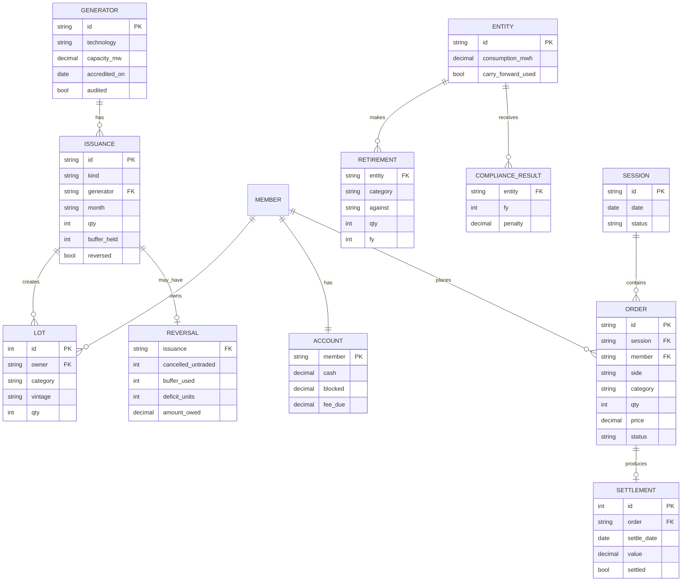

A member is any id with an account: generators, entities, or other participants.

## 9. System architecture
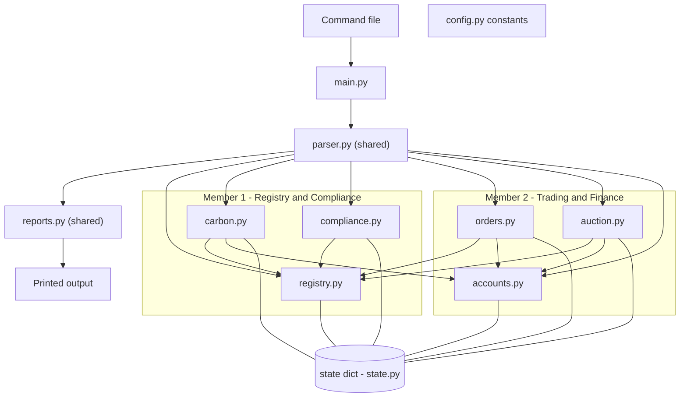

`parser.py` turns each command line into a call to one module. All modules share one state
dictionary created by `state.new_state()`.

## 10. UML class diagram
The code uses plain dictionaries, so the "classes" below document the record fields. Behaviour
lives in module functions (see Module_Ownership.md).

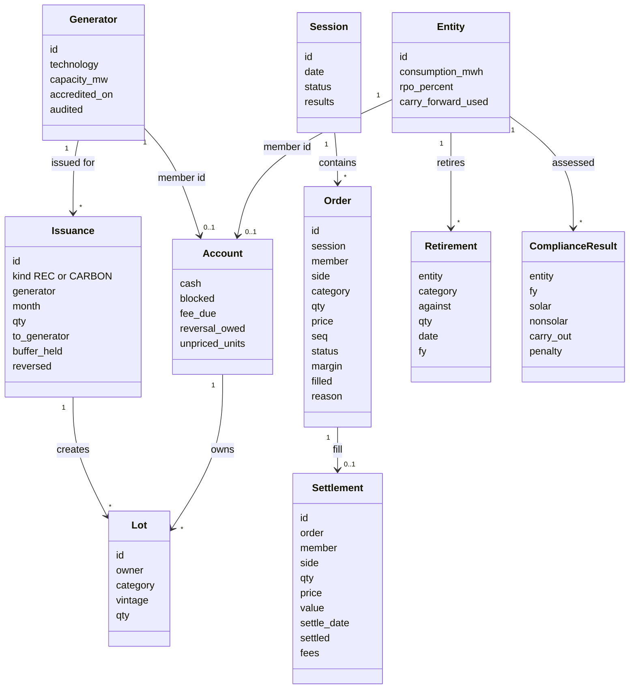

## 11. State diagram and workflows

### Certificate lifecycle
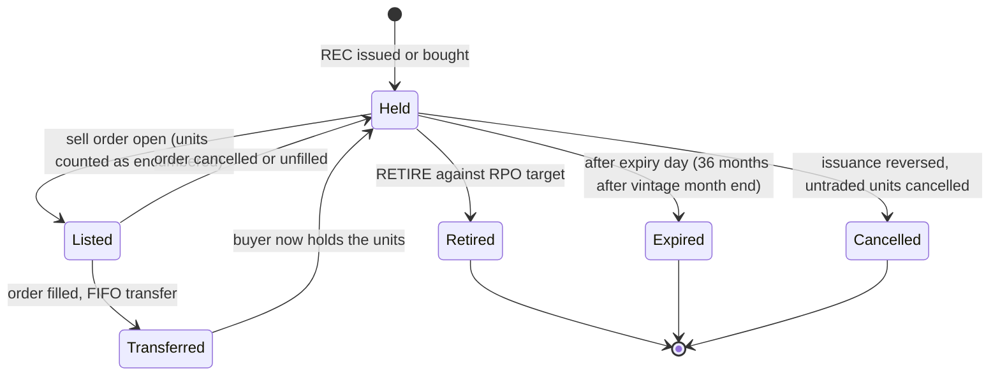

### REC issuance (BR-01)
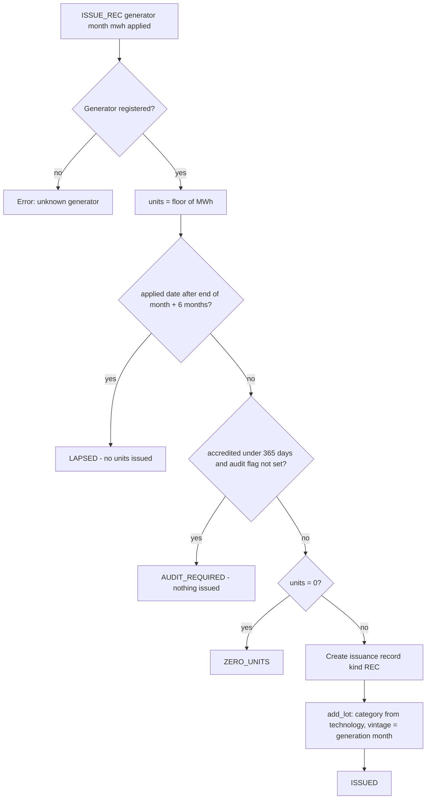

### Carbon buffer (BR-02)
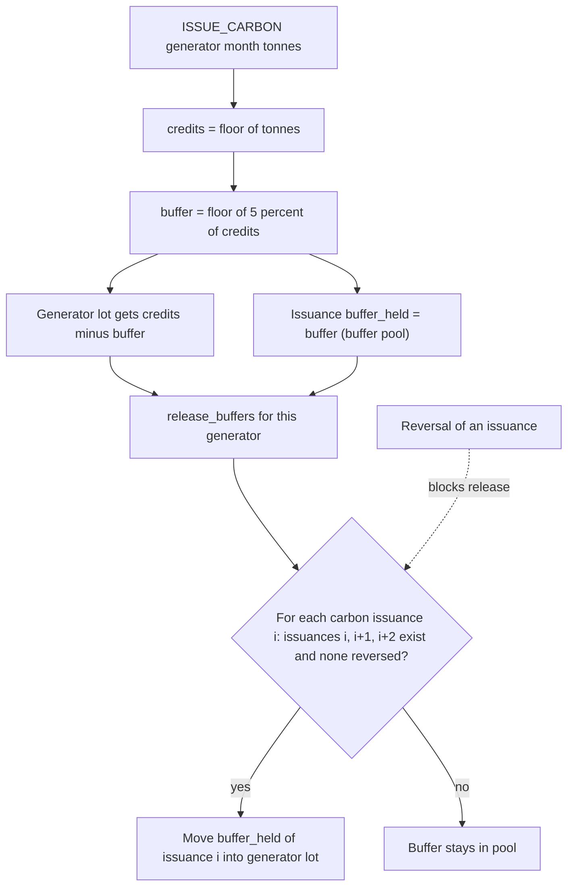

### Auction trading (BR-05, BR-06, BR-07, BR-08)
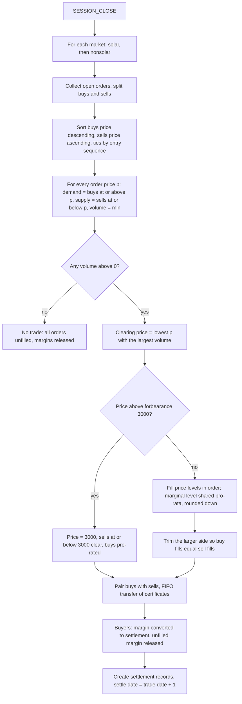

### FIFO transfer (BR-04)
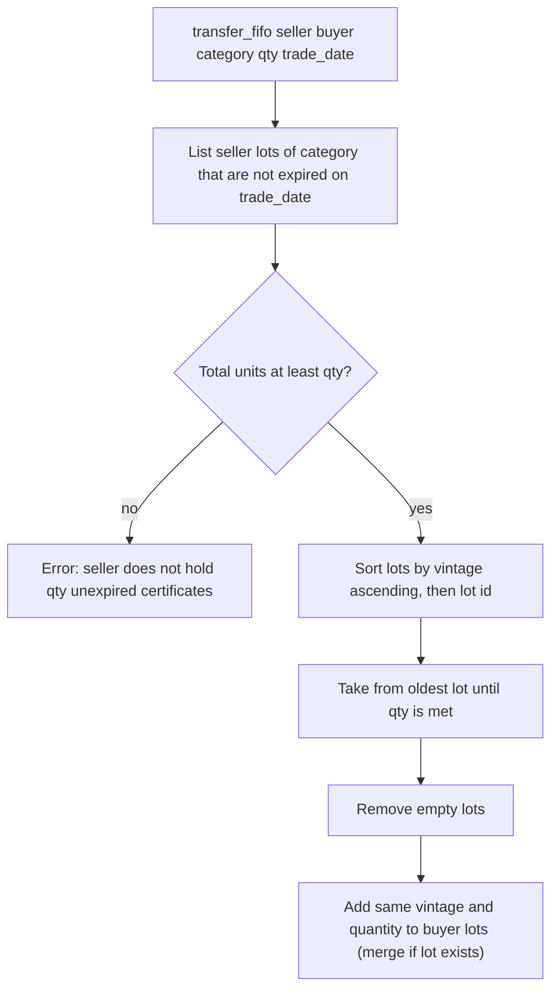

### Retirement and compliance (BR-03, BR-09)
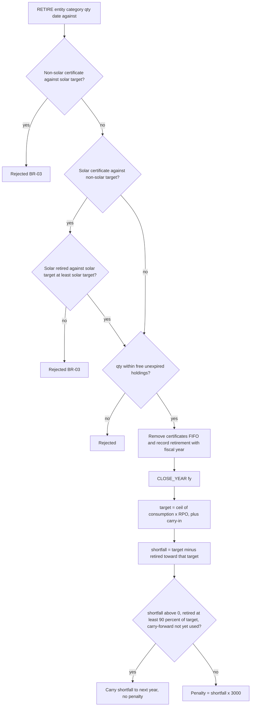

### Carbon reversal (BR-10)
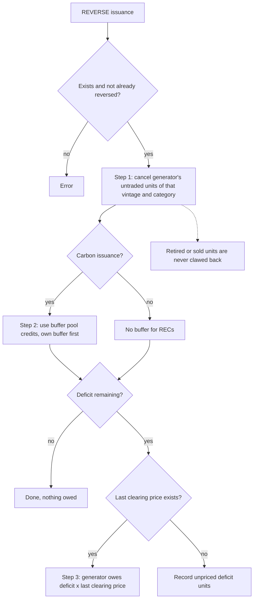

### Trade sequence
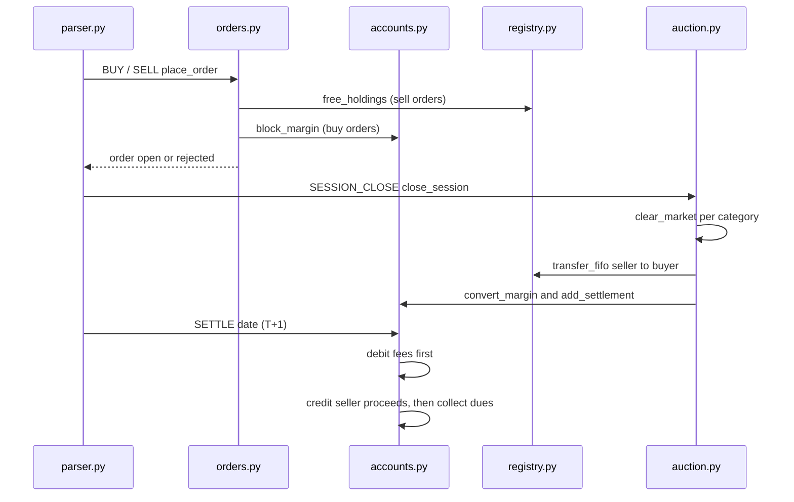

## 12. Business-rule register
See `Business_Rule_Register.md` for the full table (rule, code, owner, tests).

## 13. Module ownership
See `Module_Ownership.md`. Member 1: registry.py, carbon.py, compliance.py. Member 2: orders.py,
auction.py, accounts.py. Shared: config, state, parser, reports, main, edge-case tests.

## 14. Assumptions
Proposed, not official: see `Decision_Log.md` entries A-01 to A-17 (vintage and deadlines, buffer
rounding and release, carbon not traded, 31 March handling, RPO constants and rounding,
carry-forward once, reversal price source, clearing rule, residual trimming, forbearance guard,
fee rounding, fee shortfall, margin, audit age).

## 15. Design decisions
- One shared state dictionary instead of objects: simple to inspect and explain.
- `auction.clear_market` is a pure function; `apply_market` applies results: easy to test.
- Pairing of buyers to sellers in priority order only decides who delivers to whom; the price is
  the same for everyone.
- Encumbrance is derived from open sell orders, not stored in lots, so there is one source of truth.
- Money never goes negative: unpaid fees are tracked as `fee_due`.

## 16. Testing approach
Unit tests per module, a pure-function auction test set, a file for the eight mandatory edge
cases, an end-to-end run of the demo command file, and a check that every BR-ID has a test.
See `Test_Plan.md`. Run: `python -m unittest discover -s tests -t .`
